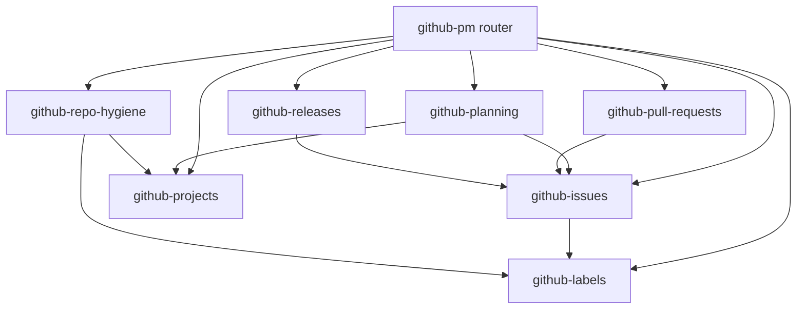

# github-pm

Agent skills for GitHub project management. An agent that has these skills can file a useful issue, run a project board, break an epic into dependent work, keep labels in sync, open a pull request, cut a release, and leave the repository with the usual hygiene files.

Each skill is one folder under `skills/`. `SKILL.md` has YAML frontmatter (`name`, `description`) and the steps the agent should follow. Optional `scripts/`, `templates/`, and `references/` sit next to it.



| Skill | What it covers |
| --- | --- |
| `github-pm` | Router. Picks the skill below and blocks destructive or bulk edits until there is a dry-run and a yes. |
| `github-issues` | Bug, feature, and task bodies. Issue forms. Triage, duplicates, assignees, sub-issues, issue types, closing keywords, milestones. |
| `github-projects` | Projects v2 with `gh project` and ProjectV2 GraphQL. Fields, board, table, and roadmap views, built-in workflows, items, bulk field edits. |
| `github-planning` | Epic breakdown, sprint and milestone planning, status reports. Mermaid dependency flowcharts and gantt roadmaps. |
| `github-labels` | Prefixed label taxonomy and `scripts/sync-labels.sh`, which dry-runs unless `--apply` is set. |
| `github-pull-requests` | PR template, draft PRs, review requests, CODEOWNERS, linking a PR to issues. |
| `github-releases` | `.github/release.yml`, draft then publish, changelog, closing the milestone. |
| `github-repo-hygiene` | CONTRIBUTING, SECURITY, Discussions, stale handling, Actions for auto-add and path labels. |

`examples/checkout-retry/` is a full pass: an epic, four child issues, a dependency diagram, the project field setup, and a status report. Nothing in that example has been filed. It is the plan the agent shows first.

## Install

Copy the skill folders into the directory your agent reads. Keep each folder name. The `name` in `SKILL.md` matches that folder.

| Agent | Project | User |
| --- | --- | --- |
| Claude Code | `.claude/skills/` | `~/.claude/skills/` |
| Cursor | `.cursor/skills/` | `~/.cursor/skills/` |
| Kiro | `.kiro/skills/` | `~/.kiro/skills/` |
| Shared Agent Skills path | `.agents/skills/` | `~/.agents/skills/` |

```bash
mkdir -p .claude/skills .cursor/skills .kiro/skills .agents/skills
cp -R skills/. .agents/skills/
# or point one agent at the same tree
cp -R skills/. .cursor/skills/
```

A project install applies to that repository. A user install applies to every repository you open with that agent.

## Check

`scripts/check.sh` parses every YAML and JSON template, checks skill frontmatter, dry-runs the label and project scripts against a fake `gh`, and renders every Mermaid fence with `@mermaid-js/mermaid-cli`.

```bash
bash scripts/check.sh
```

The renderer needs Node and Chrome. Set `PUPPETEER_EXECUTABLE_PATH` if Chrome is not on the default path.

## Safety

Skills that close, delete, transfer, prune, publish, or edit more than one object tell the agent to print the exact commands and wait. `scripts/sync-labels.sh` and `scripts/bulk-set-field.sh` exit after the plan unless `--apply` is present. `--prune` on the label script deletes labels and is refused without `--apply`.

## Docs this was checked against

Context7 was over its monthly quota, so commands were checked locally and on the docs sites.

- `gh` 2.103.0 (2026-10-21): `gh issue`, `gh project`, `gh label`, `gh pr`, `gh release`, `gh api`, and `gh repo edit --help`
- github.com GraphQL introspection on 2026-10-29 for ProjectV2 mutations, issue types, and discussions. There is no `updateProjectV2Workflow` mutation. Workflows are enabled in the project UI. `deleteProjectV2Workflow` is the workflow mutation that does exist.
- [Issue form syntax](https://docs.github.com/en/communities/using-templates-to-encourage-useful-issues-and-pull-requests/syntax-for-issue-forms), [form schema](https://docs.github.com/en/communities/using-templates-to-encourage-useful-issues-and-pull-requests/syntax-for-githubs-form-schema), [linking a pull request](https://docs.github.com/en/issues/tracking-your-work-with-issues/using-issues/linking-a-pull-request-to-an-issue), [code owners](https://docs.github.com/en/repositories/managing-your-repositorys-settings-and-features/customizing-your-repository/about-code-owners), [generated release notes](https://docs.github.com/en/repositories/releasing-projects-on-github/automatically-generated-release-notes), [milestones](https://docs.github.com/en/rest/issues/milestones), [Projects API](https://docs.github.com/en/issues/planning-and-tracking-with-projects/automating-your-project/using-the-api-to-manage-projects), [built-in automations](https://docs.github.com/en/issues/planning-and-tracking-with-projects/automating-your-project/using-the-built-in-automations)
- `actions/add-to-project` v2, `actions/labeler` v7.0.0, `actions/stale` v11.0.0
- `cli/cli` v2.103.0 source for the JSON shapes of `gh project view`, `item-list`, and `field-list`

Re-run `gh <command> --help` before using a flag when the installed `gh` is not 2.103.0.

## License

[MIT](LICENSE)
