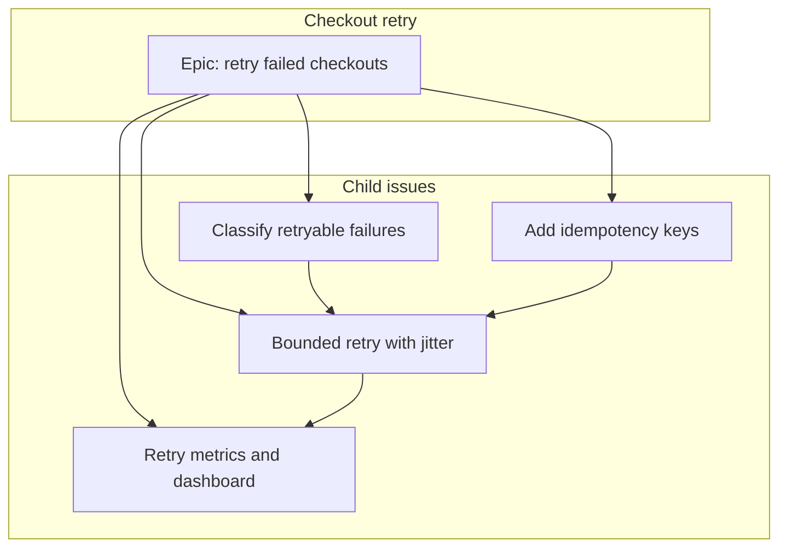
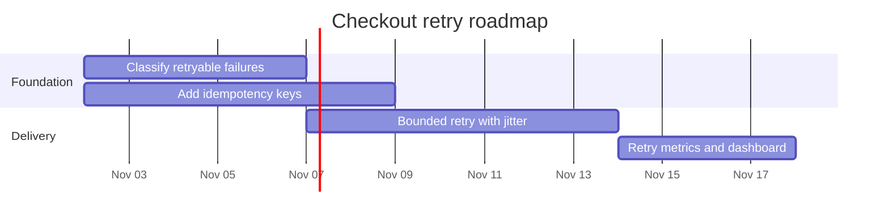
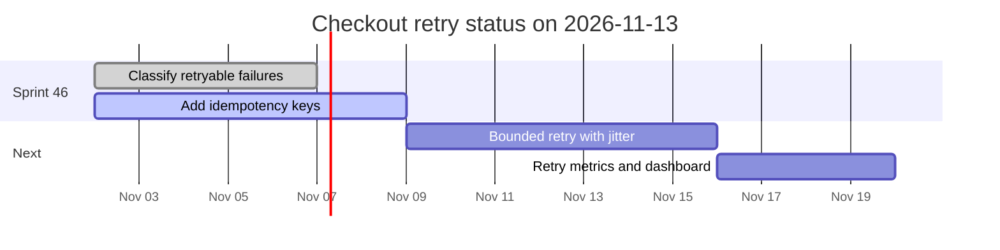

# Worked example: checkout retry

This is the plan an agent should show before it files anything. The repository is `OWNER/REPO`. The project is number 7, titled Checkout, owned by `OWNER`. None of these commands have been run.

The outcome is one sentence: a failed checkout can be retried without charging the card twice.

## Issues

| Issue | Kind | Blocked by | Estimate | Milestone |
| --- | --- | --- | --- | --- |
| Retry failed checkouts without a double charge | epic | | | v1.4 Checkout retry |
| Classify retryable checkout errors | task | | 2 | v1.4 Checkout retry |
| Add idempotency keys to the charge request | task | | 3 | v1.4 Checkout retry |
| Bounded retry with jitter | task | classify, idempotency | 5 | v1.4 Checkout retry |
| Retry metrics and a dashboard | task | retry | 2 | v1.4 Checkout retry |

Bodies are in `issues/`. The parent link is not a blocker. Classify and idempotency can land in parallel. Retry waits on both. Metrics waits on retry.



## Roadmap

Milestone `v1.4 Checkout retry`, due 2026-12-15. Sprint 46 is 14 days from 2026-11-02. Classify and idempotency are in that sprint. Retry starts after classify, on the critical path. Idempotency runs in the same window and also blocks retry.



## Commands to run after this plan is accepted

Milestone, then the epic, then the children. Replace nothing until the numbers come back. `--blocked-by` uses the numbers created above it.

```bash
gh api repos/{owner}/{repo}/milestones \
  -f title='v1.4 Checkout retry' \
  -f description='Retry failed checkouts without a double charge.' \
  -f due_on='2026-12-15T00:00:00Z'

gh issue create --title "Retry failed checkouts without a double charge" \
  --body-file examples/checkout-retry/issues/epic.md \
  --label "type:epic,needs-triage" \
  --milestone "v1.4 Checkout retry"

gh issue create --title "Classify retryable checkout errors" \
  --body-file examples/checkout-retry/issues/classify.md \
  --label "type:task,area:api,priority:p1" \
  --parent PARENT --milestone "v1.4 Checkout retry"

gh issue create --title "Add idempotency keys to the charge request" \
  --body-file examples/checkout-retry/issues/idempotency.md \
  --label "type:task,area:api,priority:p1" \
  --parent PARENT --milestone "v1.4 Checkout retry"

gh issue create --title "Bounded retry with jitter" \
  --body-file examples/checkout-retry/issues/retry.md \
  --label "type:task,area:api,priority:p1" \
  --parent PARENT --blocked-by CLASSIFY,IDEMPOTENCY \
  --milestone "v1.4 Checkout retry"

gh issue create --title "Retry metrics and a dashboard" \
  --body-file examples/checkout-retry/issues/metrics.md \
  --label "type:task,area:api,priority:p2" \
  --parent PARENT --blocked-by RETRY \
  --milestone "v1.4 Checkout retry"
```

If `OWNER` is an organization and it has Task and a custom Epic type, use `--type` instead of `type:task` and `type:epic`. User-owned repositories have no issue types.

## Project fields

List fields first. Status already exists. Create the rest only when the names are absent.

```bash
gh project field-list 7 --owner OWNER --format json --limit 100

gh project field-create 7 --owner OWNER --name "Priority" \
  --data-type SINGLE_SELECT --single-select-options "P0,P1,P2,P3"

gh project field-create 7 --owner OWNER --name "Estimate" --data-type NUMBER
gh project field-create 7 --owner OWNER --name "Target date" --data-type DATE
```

Sprint is an iteration field. `gh project field-create` cannot create one.

```bash
gh api graphql -f projectId='PROJECT_ID' -f query='
  mutation($projectId: ID!) {
    createProjectV2Field(input: {
      projectId: $projectId
      dataType: ITERATION
      name: "Sprint"
      iterationConfiguration: {
        startDate: "2026-11-02"
        duration: 14
        iterations: [
          { title: "Sprint 46", startDate: "2026-11-02", duration: 14 }
        ]
      }
    }) {
      projectV2Field {
        ... on ProjectV2IterationField { id name }
      }
    }
  }
'
```

Add each new issue, then set fields. One field per `item-edit` call.

```bash
gh project item-add 7 --owner OWNER --url https://github.com/OWNER/REPO/issues/NUMBER

gh project item-edit 7 --owner OWNER \
  --url https://github.com/OWNER/REPO/issues/CLASSIFY \
  --field "Priority" --value "P1"

gh project item-edit --id ITEM_ID --project-id PROJECT_ID --field-id ESTIMATE_FIELD_ID --number 2
gh project item-edit --id ITEM_ID --project-id PROJECT_ID --field-id SPRINT_FIELD_ID --iteration-id SPRINT_46_ID
gh project item-edit --id ITEM_ID --project-id PROJECT_ID --field-id TARGET_FIELD_ID --date 2026-11-06
```

Views:

```bash
gh api graphql -f projectId='PROJECT_ID' -f query='
  mutation($projectId: ID!) {
    board: createProjectV2View(input: { projectId: $projectId, name: "Board", layout: BOARD_LAYOUT }) {
      projectV2View { id name }
    }
    table: createProjectV2View(input: { projectId: $projectId, name: "Backlog", layout: TABLE_LAYOUT }) {
      projectV2View { id name }
    }
    roadmap: createProjectV2View(input: { projectId: $projectId, name: "Roadmap", layout: ROADMAP_LAYOUT }) {
      projectV2View { id name }
    }
  }
'
```

Group the board by Status in the project UI. The view mutation does not take a group-by field.

## Status report

Written 2026-11-13 from the board, not from the original wish list.

- Project status: ON_TRACK
- Milestone: v1.4 Checkout retry, due 2026-12-15
- Iteration: Sprint 46, 2026-11-02 to 2026-11-15

Classify retryable checkout errors is done. Idempotency keys are in progress and about half landed. Retry has not started. It is still blocked by idempotency. The date risk is small: retry was planned to start after classify, and it can start as soon as the key is on the charge request.



Posting this on the project is a separate yes:

```bash
gh api graphql -f projectId='PROJECT_ID' -f body='On track. Classify is done. Idempotency is in progress. Retry starts when the charge request sends an idempotency key.' -f query='
  mutation($projectId: ID!, $body: String!) {
    createProjectV2StatusUpdate(input: {
      projectId: $projectId
      body: $body
      status: ON_TRACK
      startDate: "2026-11-02"
      targetDate: "2026-12-15"
    }) {
      statusUpdate { id }
    }
  }
'
```
