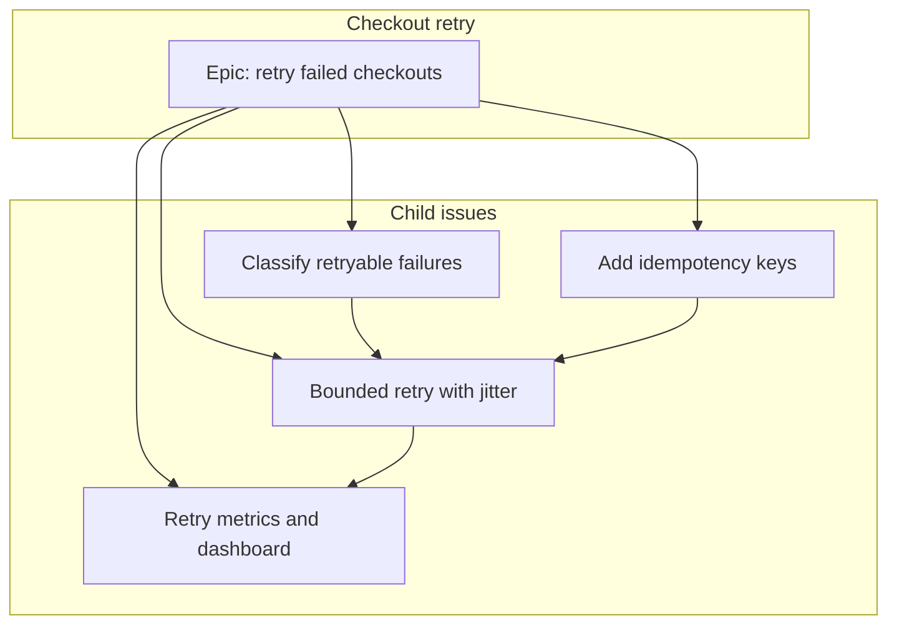

## Outcome

A checkout that fails with a retryable error can be submitted again without charging the card a second time.

## Context

Charge requests today are not idempotent, and the client treats every failure as final. Callers build their own retries and sometimes double-charge. This epic is the parent for that work. The dependency picture is the flowchart below. The blocked-by links on the child issues are the source of truth.

## Done when

- [ ] Retryable failures are an explicit list, not a guess in the client
- [ ] A repeated charge request with the same idempotency key does not create a second charge
- [ ] The client retries that list with a bounded delay and jitter
- [ ] Retry attempts and exhausted budgets are visible on a dashboard

## Out of scope

Refunds, the dispute flow, and retries for caller bugs such as a 400.

