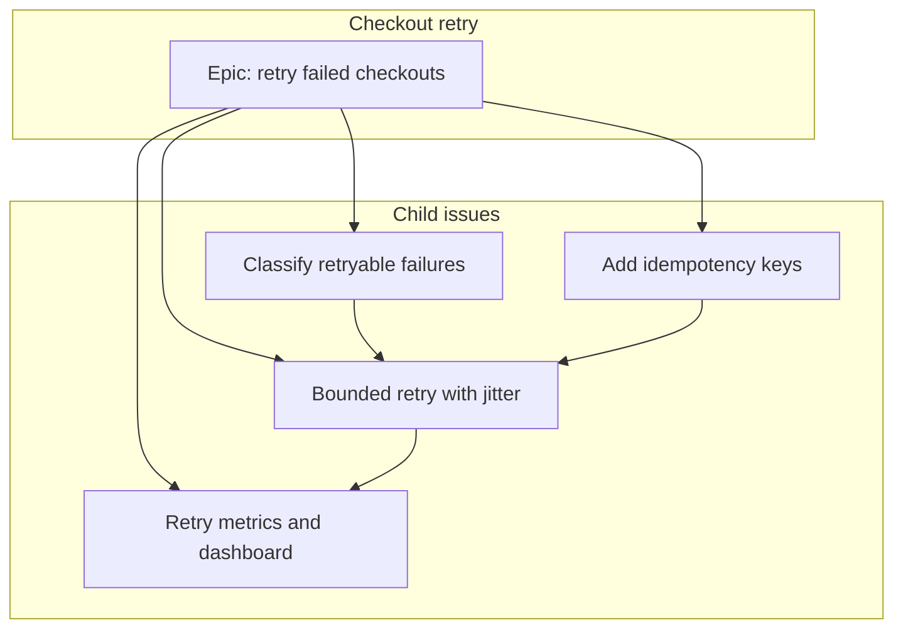
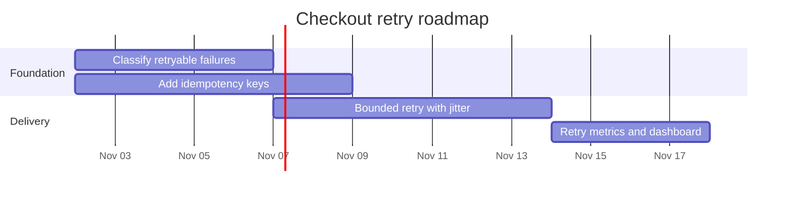

# Planning

Follow `github-pm` for dry-run and confirmation. This skill produces a plan. It does not file issues or edit a project until the user accepts the plan. After they accept, use `github-issues` to create the issues and `github-projects` to set fields.

A worked example is in `examples/checkout-retry/` at the repository root.

## Break an epic into issues

Read the spec and name one outcome. That outcome is the parent issue. Split it into children a single change can finish. Each child has:

- A title that says the outcome, not the area ("Classify retryable checkout errors", not "Errors")
- A task or feature body (see `github-issues`)
- The parent link
- `blocked-by` only for a real predecessor. Do not mark every child as blocked by the epic
- One area label, one priority, and an estimate
- A milestone when the work ships together, and an iteration when it is scheduled

Keep the dependency graph a DAG. If two issues need each other, split or drop one edge.

Put the DAG in the epic body with a Mermaid flowchart. Use subgraphs for the epic and for the child issues. Validate the fence before showing the plan (see `references/mermaid.md`).



Show the plan as a table, then the commands you would run. Do not run them yet.

| Issue | Type | Blocked by | Estimate | Milestone |
| --- | --- | --- | --- | --- |
| Epic: retry failed checkouts | epic | | | v1.4 |
| Classify retryable failures | task | | 2 | v1.4 |
| Add idempotency keys | task | | 3 | v1.4 |
| Bounded retry with jitter | task | classify, idempotency | 5 | v1.4 |
| Retry metrics and dashboard | task | retry | 2 | v1.4 |

After acceptance, create the parent, then each child with `--parent` and `--blocked-by`. Record the new numbers and say which command used which number.

## Sprint and iteration planning

An iteration is a project field, not a milestone. A milestone is a repository due date. Use both when a sprint is a slice of a larger ship.

1. List the iteration field (`github-projects` GraphQL). Create it only if it is missing. A two-week sprint uses `duration: 14`.
2. Take the open children that are not blocked by unfinished work.
3. Fill the sprint until the estimate sum hits the capacity the user gave. If they gave none, ask. Do not invent a velocity.
4. Set Sprint, Status, Priority, and Estimate on those items. Setting many items is a bulk edit: dry-run with `skills/github-projects/scripts/bulk-set-field.sh`, then wait.

Leave blocked work on the backlog with Status Todo and no iteration.

## Roadmap and milestones

Group issues into milestones by ship date, not by sprint. Create the milestone with the REST call in `github-issues` (`references/milestones.md`) only after the user accepts the title and `due_on`.

Draw the roadmap as a Mermaid gantt. Every task needs an id. Use `after <id>` for a dependency so the chart matches the DAG.



The gantt shows the critical path. Idempotency runs beside classification and also blocks retry; the flowchart is the full DAG.

A Projects roadmap view (`ROADMAP_LAYOUT`) reads a date field. Create Target date if `field-list` does not already show one, then set dates per item. The view mutation cannot set the group-by field. Say so and point at the UI for that part.

## Status report

Copy `templates/status-report.md`. Fill it from the live project, not from the original plan.

```bash
gh project item-list NUMBER --owner OWNER --format json --limit 100
gh issue list --milestone "MILESTONE" --state all --limit 50 --json number,title,state,milestone
```

Lead with the status word (`ON_TRACK`, `AT_RISK`, `OFF_TRACK`, `COMPLETE`, `INACTIVE`), then what finished, what is in progress, what is next, and the risks. Include the gantt. Validate every Mermaid fence.

Publishing the report with `createProjectV2StatusUpdate` posts it on the project. Show the mutation from `github-projects` and wait. Saving the markdown in the repo or a comment does not need that mutation.

## Order of operations

1. Write the epic, the child table, the flowchart, and the gantt.
2. Validate Mermaid.
3. Stop for acceptance.
4. Create the milestone, the parent issue, and the children.
5. Add them to the project and set fields.
6. Later, write the status report from the board.
