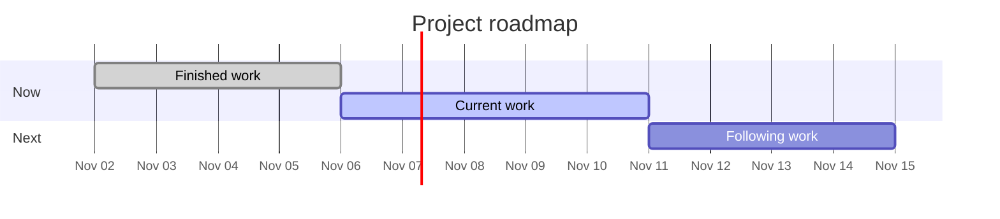
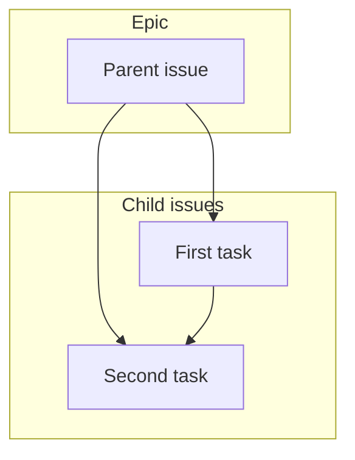

# Status report: PROJECT NAME

- Date: YYYY-MM-DD
- Project status: ON_TRACK
- Milestone: MILESTONE (due YYYY-MM-DD)
- Iteration: SPRINT NAME

## Summary

One short paragraph a reader who missed the week can use.

## Finished

- #101 Title

## In progress

- #102 Title. Owner. What is left.

## Next

- #103 Title. It is blocked by #102.

## Risks

- Risk, the consequence, and the next step.

## Roadmap

## Dependency view

